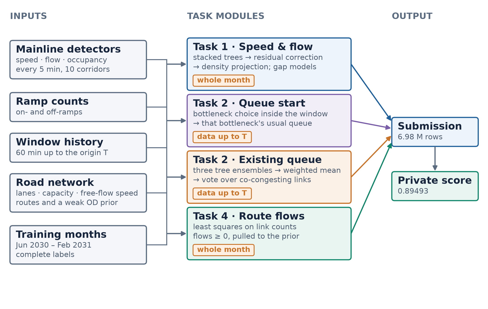
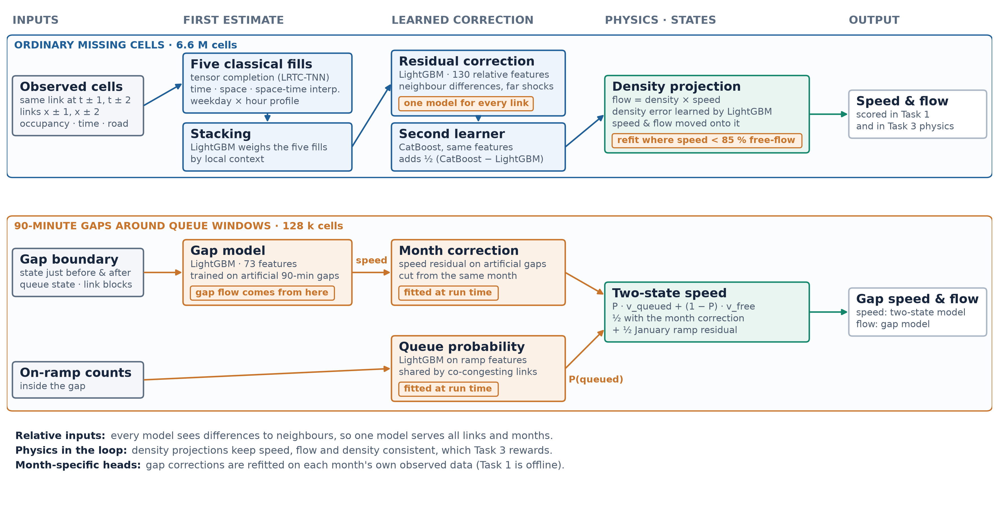
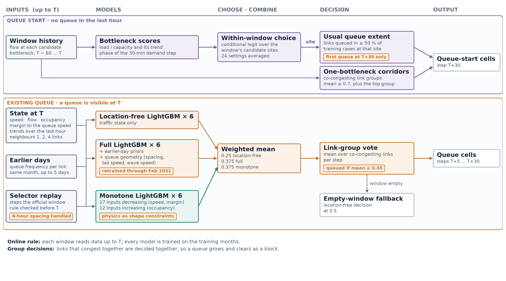

# Method overview

The four tasks of the competition are split into four modules. Each module starts from the released
data and produces one part of the answer. The parts are then assembled into one submission file in
the official row order. The selected final submission scored 0.89493 on the private leaderboard.

## 1. System

- **Inputs:**
  - mainline detector data: speed, flow and occupancy every 5 minutes, with part of the cells
    withheld by the organisers;
  - on-ramp and off-ramp counts;
  - for each Task 2 window, the 60 minutes of history before the forecast origin T;
  - the network: lanes, free-flow speed, capacity and paths;
  - the fully observed training months, the only source of labels.
- **Task 1: speed and flow for missing cells.** Speed and flow are estimated for every withheld
  cell. The Task 3 traffic-physics score is computed on these values.
- **Task 2: new queues (onset).** For links that were free over the last hour, forecast where a queue
  starts in the next 30 minutes.
- **Task 2: existing queues (ongoing).** For links queued at the origin, forecast whether the queue
  persists, grows or clears in the next 30 minutes.
- **Task 4: path flows.** Each path's flow is estimated so that the link sums match the released link
  counts.
- **Time rule:**
  - Each Task 2 window reads data up to T: its own 60-minute history, earlier days of the same
    month, and the training months.
  - Every Task 2 model is trained on the training months.
  - Tasks 1, 3 and 4 may use the whole month of released data.

## 2. Task 1: missing speed and flow

### Scattered missing cells (the 8 corridors with Task 2 windows)

1. **Five classical fills** (Five classical fills in the diagram):
   - low-rank tensor completion (LRTC-TNN), which uses the shared link × time × day structure;
   - temporal, spatial and space–time interpolation;
   - the weekday × time-of-day profile.
2. **Stacking** (Stacking). LightGBM, a gradient-boosted tree model, learns how much weight each of
   the five fills gets, from the observations around each cell.
3. **Residual correction** (Residual correction). A second LightGBM learns the error left by the
   stack. Its inputs are all relative: differences to the previous and next time steps, to the
   upstream and downstream links, and shocks from links further away. One model therefore serves
   every link.
4. **Density projection** (Density projection). Flow equals density times speed. On five corridors,
   speed and flow are moved toward a learned density, so that the three agree.
5. **Density correction** (second and third lines of Density projection). Another model learns the
   remaining density error, and speed and flow are projected onto the corrected density.
6. **Second learner** (Second learner). CatBoost repeats the residual correction, and half of its
   difference to the LightGBM result is added back.
7. **Refit in congestion** (orange label "refit where speed < 85 % free-flow"). For cells below 85% of
   free-flow speed, the density correction is learned once more on top of the earlier result.

Task 3 checks the traffic physics of the submitted speed and flow: the fundamental diagram and
vehicle conservation in the LWR model. Steps 4, 5 and 7 keep speed, flow and density consistent,
which raises the Task 1 and Task 3 scores together.

### The corridor pair without Task 2 windows

The D12_I405 northbound and southbound corridors have Task 1 cells only. They use the residual
correction trained on the other 8 corridors, plus a small correction fitted on their own training
months.

### The 90-minute blanked interval after each Task 2 origin

After each Task 2 origin, the 30-minute horizon and the following 60 minutes are withheld on the
whole mainline. These cells are Task 1 targets. Since the gap is one continuous block, it has its own
models.

1. **Gap model** (Gap model):
   - trained on 90-minute gaps cut into the training months;
   - inputs are the traffic state before and after the gap, the queue state, and the groups of links
     that usually queue together;
   - the flow inside the gap comes from this model.
2. **Month correction** (Month correction). During the run, artificial gaps are cut into the observed
   data of the same month, and a speed correction is fitted on them. Task 1 may use the whole month,
   so this follows the rules.
3. **Two-state speed** (Two-state speed):
   - speed = queue probability × queued speed + (1 − queue probability) × free-flow speed;
   - links that usually queue together share one queue probability.
4. **Queue probability from the ramps** (Queue probability):
   - when the mainline queue spills back, the on-ramp that joins it is blocked too, and its count
     drops;
   - the on-ramp counts inside the gap, scaled to the level of the same month, therefore act as a
     queue sensor;
   - they give the queue probability, and with it the final speed inside the gap.

## 3. Task 2: queue forecasting

Each window uses data up to the forecast origin T.

### Onset windows

In the official onset windows, the first queued cell always appears in the last 5-minute step, T+30.
Only T+30 is therefore predicted, and the earlier steps are set free.

- **Corridors with several bottlenecks** (Bottleneck scores → Within-window choice → Usual queue
  extent):
  - each candidate bottleneck gets three quantities: load relative to capacity, its trend, and when
    the next demand step reaches the bottleneck;
  - a within-window choice model (conditional logit) compares the candidates of the same window and
    picks the one most likely to break first;
  - the links where that bottleneck's training queues appeared at least 50% of the time are marked
    queued.
- **Corridors with one main bottleneck** (One-bottleneck corridors):
  - links that usually queue together form one group;
  - a group is marked queued when its mean probability reaches 0.7, and the most probable group is
    always included.
- **The corridor with spread-out onsets (D7_I210 westbound).** A general onset model (75 traffic
  features) with per-link thresholds for this corridor.

### Ongoing windows

- **What the models see (all at or before T):**
  - speed, flow, occupancy, the distance to the queue threshold, and their trends;
  - the same for the upstream and downstream links;
  - ramp flows;
  - how often the link queued on earlier days of the same month;
  - what the official window-selection rule can see before T. The rule scans step by step, and two
    windows are at least 6 hours apart; the times the rule checked before T are replayed to judge
    how stable the queue was before T.
- **Three ensembles of 6 LightGBM models each:**
  1. **Location-agnostic ensemble** (Location-free LightGBM × 6). Its inputs are traffic-state values
     only, so it learns how queues evolve in general and carries over to new months.
  2. **Selection-aware ensemble** (Full LightGBM × 6). It adds the queue frequency of earlier days and
     the queue geometry: queue spacing, tail speed and shock-wave speed.
  3. **Monotone ensemble** (Monotone LightGBM × 6). 29 inputs carry monotone constraints: lower speed
     and higher occupancy give a higher queue probability.
- **Blend** (Weighted mean). Each link's probability = 0.25 × location-agnostic + 0.75 × the mean of
  the selection-aware and monotone ensembles.
- **Group decision** (Link-group vote). The probability is averaged within each group of links that
  queue together, step by step. A group whose mean reaches 0.45 is marked queued.
- **Empty-window fallback** (Empty-window fallback). When a window ends up with no queued cell, the
  location-agnostic ensemble at threshold 0.5 decides it.

## 4. Task 4: path flows

Each corridor and month is solved on its own:

- non-negative path flows whose link sums come closest to the released link counts;
- held close to the organisers' weak prior, with weight 0.05.
