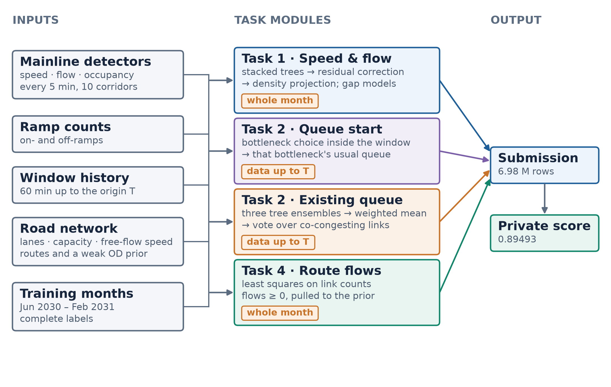
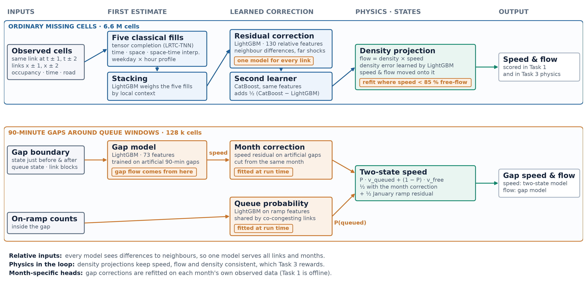
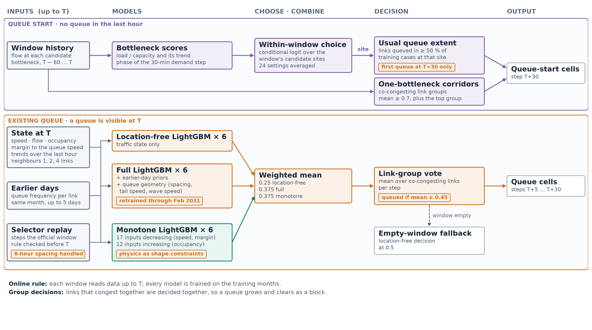

# 方法概要

我們把比賽的四個任務拆成四個模組。每個模組從公布的資料出發，各自產生一部分答案，最後依官方的列序合成一個提交檔。最終勾選的提交在 private 榜得到 0.89493。

## 1. 整體架構

- **輸入**：
  - 主線偵測器資料：每 5 分鐘的速度、流量、佔有率，其中一部分格被官方挖空；
  - 入口與出口匝道計數；
  - 每個 Task 2 窗在預測起點 T 之前 60 分鐘的歷史；
  - 路網資訊：車道數、自由流速、容量、路徑；
  - 訓練月份的完整資料，也是唯一的標註來源。
- **Task 1：補齊速度與流量。** 對每個被挖空的格估計速度與流量。Task 3 的交通物理分數也用這些值計算。
- **Task 2：隊列起始。** 預測過去一小時都暢通的路段，在接下來 30 分鐘內哪裡開始排隊。
- **Task 2：已有隊列。** 預測起點已經排隊的路段，在接下來 30 分鐘內隊列持續、延長或消散。
- **Task 4：路徑流量。** 估計每條路徑的流量，讓各路段的加總符合公布的路段計數。
- **時間規則**：
  - Task 2 的每個窗只讀到 T 為止的資料，包括該窗前 60 分鐘、同一個月份較早的日子，以及訓練月份。
  - Task 2 的模型全部用訓練月份訓練。
  - Task 1、3、4 可使用整個月份的公布資料。

## 2. Task 1：補齊缺失的速度與流量

### 一般缺值（8 條有 Task 2 窗的走廊）

1. **五種傳統補值**（圖中 Five classical fills）。
   - 低秩張量補全（LRTC-TNN），利用「路段 × 時刻 × 日期」的共同結構；
   - 時間內插、空間內插、時空內插；
   - 星期 × 時段的歷史平均。
2. **堆疊模型**（圖中 Stacking）。 LightGBM 是一種梯度提升樹。它依據每一格周圍的觀測情況，學習五種補值各自該占多少權重。
3. **殘差修正**（圖中 Residual correction）。 第二個 LightGBM 學習堆疊結果剩下的誤差。輸入全部是相對量：前後時刻的差異、上下游鄰近路段的差異、遠處路段的衝擊。因此同一個模型適用於每一條路段。
4. **密度投影**（圖中 Density projection）。 流量等於密度乘以速度。在 5 條走廊上，速度與流量朝一個學到的密度調整，讓三者彼此一致。
5. **密度修正**（圖中 Density projection 的第二、三行）。 另一個模型學習剩下的密度誤差，再把速度與流量投影到修正後的密度上。
6. **第二種學習器**（圖中 Second learner）。 用 CatBoost 重做殘差修正，再把它與 LightGBM 結果之差的一半加回去。
7. **壅塞路段再修正**（圖中橘色標籤 refit where speed < 85 % free-flow）。 速度低於自由流速 85% 的格，以前面的結果為基礎，重新學一次密度修正。

Task 3 用提交的速度與流量檢查交通物理，包括基本圖，以及 LWR 模型的車輛守恆。第 4、5、7 步讓速度、流量、密度彼此一致，同時提升 Task 1 與 Task 3 的分數。

### Task 2 以外的一對走廊

資料中的 D12_I405 南北向走廊只有 Task 1 的格。這對走廊沿用其他 8 條走廊訓練的殘差修正，再加上一個用這對走廊訓練月份資料擬合的小型修正。

### Task 2 窗周圍的 90 分鐘空白

每個 Task 2 窗之後，30 分鐘的預測時段加上再往後的 60 分鐘，主線資料全部被挖空。這些格屬於 Task 1 要補的格，因為整段連續空白，所以用專門的模型處理。

1. **空白補值模型**（圖中 Gap model）。
   - 在訓練月份人工挖出 90 分鐘空白來訓練；
   - 輸入是空白前後的交通狀態、排隊狀況，以及常一起壅塞的路段群；
   - 空白期間的流量採用這個模型的結果。
2. **月份專屬修正**（圖中 Month correction）。 執行時，在同一個月份已觀測的資料上挖出人工空白，擬合速度修正。Task 1 可使用整個月份，這個做法符合規則。
3. **暢通與排隊的混合**（圖中 Two-state speed）。
   - 速度 = 排隊機率 × 排隊時的速度 +（1 − 排隊機率）× 暢通時的速度；
   - 常一起壅塞的路段共用同一個排隊機率。
4. **看匝道的排隊機率**（圖中 Queue probability）。
   - 主線回堵時，接上主線的入口匝道也跟著塞住，匝道計數隨之下降；
   - 空白期間的入口匝道計數，換算成相對同一個月份的水準後，就成為排隊的感測器；
   - 用它估計排隊機率，得到空白期間最後的速度。

## 3. Task 2：隊列預測

每個窗只使用到預測起點 T 為止的資料。

### 隊列起始窗

官方的起始窗裡，第一個排隊格一律出現在最後一個 5 分鐘時段，也就是 T+30。因此我們只預測 T+30，前面各時段保持暢通。

- **有多個瓶頸的走廊**（圖中 Bottleneck scores → Within-window choice → Usual queue extent）。
  - 每個候選瓶頸計算三個量：負載相對容量、變化趨勢，以及下一次需求上升抵達瓶頸的時間點。
  - 窗內比較模型（conditional logit）在同一個窗的候選瓶頸之間，選出最可能先崩潰的一個。
  - 再標出這個瓶頸在訓練資料中常排隊的路段，標準是出現率達 50% 以上。
- **只有一個主要瓶頸的走廊**（圖中 One-bottleneck corridors）。
  - 常一起壅塞的路段分成一組；
  - 組內平均機率達 0.7 以上的組標為排隊，再加上機率最高的一組。
- **起始點分散的走廊（D7_I210 西向）。** 使用通用的隊列起始模型（75 個交通特徵），搭配這條走廊自己的判定門檻。

### 已有隊列的窗

- **模型看到的資訊（全部在 T 以前）：**
  - 速度、流量、佔有率、離排隊門檻的距離，以及各自的趨勢；
  - 上下游路段的同樣資訊；
  - 匝道流量；
  - 這條路段在同一個月份較早日子排隊的頻率；
  - 官方選窗規則在 T 以前能看到的資訊。選窗規則逐時段掃描，而且兩個窗之間至少相隔 6 小時；我們重現這條規則在 T 以前實際檢查過的時刻，用來判斷 T 之前隊列的穩定程度。
- **三組模型，各 6 個 LightGBM：**
  1. **通用位置模型**（圖中 Location-free LightGBM × 6）。 輸入只有交通狀態的數值，學到的是隊列如何演變的一般規律，適用於新的月份。
  2. **完整模型**（圖中 Full LightGBM × 6）。 再加入較早日子的排隊頻率，以及隊列幾何：隊列間距、隊尾速度、衝擊波速度。
  3. **物理約束模型**（圖中 Monotone LightGBM × 6）。 29 個輸入加上單調約束：速度越低、佔有率越高時，預測的排隊機率越高。
- **混合**（圖中 Weighted mean）。 每條路段的機率 = 0.25 × 通用位置模型 + 0.75 × 完整模型與物理約束模型的平均。
- **依路段群判定**（圖中 Link-group vote）。 在常一起壅塞的路段群內平均機率，逐時段判斷。平均值達 0.45 以上時，整群標為排隊。
- **空窗保護**（圖中 Empty-window fallback）。 一個窗的排隊格數為零時，改用通用位置模型在門檻 0.5 下的判定。

## 4. Task 4：路徑流量

每條走廊、每個月份分別求解：

- 找一組大於等於零的路徑流量，讓它們在各路段的加總最接近公布的路段計數；
- 同時貼近官方提供的弱先驗，權重 0.05。
